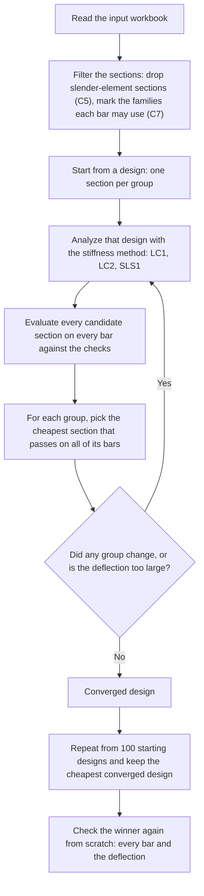

# Cost-Based Member Sizing of Steel Trusses

An optimization engine, written in R, that sizes the members of planar steel trusses. For each group of members it picks a real section from the AISC Shapes Database and returns the cheapest combination that passes every design check of AISC 360-16 (LRFD). All 15 final designs were then checked independently in SAP2000.

By Aurdhva Choudhary and Divyansh Bagla.

## Why this project

Most steel truss members are still sized by trial and error. Research on truss optimization usually minimizes weight using abstract member areas, but a real member must come from a table of rolled or formed sections, and an owner pays for installed cost, not weight.

This project answers a practical question: **which real sections, in which section family, give the cheapest truss that still passes every check of the design code?**

## What the engine does

1. Reads one Excel workbook per truss: joints, bars, member groups, supports, loads, section families and cost rates.
2. Analyzes every candidate design with the direct stiffness method, including the self-weight of the chosen sections.
3. Checks every bar against AISC 360-16 LRFD: tension, compression, slenderness, local buckling, deflection, HSS joint limits, and the bending each bar takes from its own weight.
4. Prices the design with installed cost rates per pound (RSMeans, Chicago, 2026 Q3).
5. Searches from 100 starting designs and keeps the cheapest design that passes every check.
6. Repeats this for five section systems, from welded tubes to bolted angles and W shapes, so the result also shows which way of building the truss is cheapest.

The truss shape, layout, supports and member groups are fixed inputs. Only the member sizes change, so a new truss needs a new workbook and no change to the code beyond the file path.

## Results

The engine was run on three trusses, each built five ways. All 15 designs pass every check.

**Cost (USD) and steel weight of the cheapest design for each truss and system**

| Truss | S1 rectangular HSS | S2 round HSS and pipe | S3 WT and 2L | S4 2L | S5 W | Cheapest |
| --- | --- | --- | --- | --- | --- | --- |
| Truss 1 | 35,033 / 10,982 lb | **32,840 / 10,662 lb** | 78,405 / 20,382 lb | 91,886 / 21,723 lb | 50,793 / 15,677 lb | S2 |
| Truss A | 10,419 / 3,266 lb | **10,090 / 3,276 lb** | 19,006 / 5,294 lb | 22,971 / 5,430 lb | 16,677 / 5,147 lb | S2 |
| Truss B | **2,369 / 743 lb** | 2,545 / 826 lb | 4,519 / 1,244 lb | 5,491 / 1,298 lb | 4,332 / 1,286 lb | S1 |

**The winning designs**

| Truss | System | G1 top chord | G2 bottom chord | G3 verticals | G4 diagonals |
| --- | --- | --- | --- | --- | --- |
| Truss 1 | S2 | HSS6.625X0.375 | Pipe14STD | HSS3.500X0.125 | HSS8.625X0.375 |
| Truss A | S2 | HSS6.875X0.250 | HSS4.000X0.313 | HSS3.500X0.216 | HSS4.000X0.220 |
| Truss B | S1 | HSS2-1/2X1-1/2X1/4 | HSS5X4X3/16 | HSS2-1/2X2-1/2X1/8 | HSS2-1/2X1-1/2X3/16 |

What stands out:

- **Welded tubes are the cheapest on every truss.** The two tube systems, S1 and S2, are within 3% to 7% of each other.
- **The bolted systems cost about 1.5 to 2.8 times as much.** Rupture at the bolt holes governs their tension members, open sections are less efficient in compression and bending, and double angles carry the highest rate per pound.
- **The cheapest design is not always the lightest.** On Truss A, S1 is 10 lb lighter than S2 but costs USD 329 more, because round HSS costs less per pound.
- **The search uses the available strength.** In 13 of the 15 designs the most heavily used bar is at a ratio of 0.98 or more.

## The design problem

A design is one section per member group. For one section system, the engine solves:

```math
\min_{\mathbf{x}} \; C(\mathbf{x}) \quad \text{subject to} \quad g_k(\mathbf{x}) \le 0 \;\; \text{for every check } k, \qquad x_g \in \mathcal{C}_g
```

Here $`\mathbf{x}`$ is the design, $`C`$ is its cost, each $`g_k`$ is one design check and $`\mathcal{C}_g`$ is the list of candidate sections for group $`g`$. Every check is written the same way, as demand over capacity minus one, so a design passes when every value is zero or less:

```math
g_k = \frac{\text{demand}}{\text{capacity}} - 1 \le 0
```

The choices are items in a list, so there is no smooth path to follow toward the best design. With four groups, each system has between about 3 billion and 26 billion possible designs.

### Section systems

A truss is fabricated with one way of connecting its members, and that choice decides which families can meet at a joint. The engine sizes the truss once for each system.

| System | Chords | Web members | Connections |
| --- | --- | --- | --- |
| S1 | Rectangular or square HSS | Rectangular or square HSS | Welded |
| S2 | Round HSS or pipe | Round HSS or pipe | Welded |
| S3 | WT | Double angles | Bolted |
| S4 | Double angles | Double angles | Bolted |
| S5 | W | W or double angles | Bolted |

### Member groups and candidate sections

Every truss has four member groups: G1 top chord, G2 bottom chord, G3 verticals and G4 diagonals. All bars in a group get the same section.

The candidates come from six families of the AISC Shapes Database v15.0: rectangular HSS, round HSS, pipe, WT, double angles and W. Of the 1,982 sections in those families, the engine keeps the 1,288 that have no slender elements.

### Design checks

| Check | What it limits | Source | Applies to |
| --- | --- | --- | --- |
| C1 | Tension strength, combined with bending | AISC 360-16 D2, D3, H1 | Every tension bar |
| C2 | Compression strength, combined with bending | AISC 360-16 E3, E4, H1 | Every compression bar |
| C3 | Compression slenderness, 200 maximum | AISC 360-16 E2 user note | Every compression bar |
| C4 | Tension slenderness, 300 maximum | AISC 360-16 D1 user note | Every tension bar |
| C5 | Width-to-thickness ratio of each element | AISC 360-16 Table B4.1a | Every section, before the search |
| C6 | Deflection under D + L | IBC Table 1604.3 | The whole truss |
| C7 | Section family allowed for the member's role | Section systems table above | Every bar |
| C8 | HSS joint limits | AISC 360-16 Chapter K | Systems S1 and S2 |

### Loads

Each truss carries dead load D and live load L at its joints, plus the self-weight of every bar. Two strength combinations and one service combination are used:

```math
\text{LC1} = 1.4D, \qquad \text{LC2} = 1.2D + 1.6L, \qquad \text{SLS1} = D + L
```

### Self-weight bending

The usual truss model treats each bar as carrying axial force only. A bar also bends under its own weight between its joints, and an optimizer leaves no spare margin to hide that moment. The engine therefore adds the mid-length moment of each bar, amplifies it on compression bars, and checks axial force and bending together:

```math
M_{sw} = \frac{w \cos\theta \cdot L^2}{8}, \qquad B_1 = \frac{C_m}{1 - \alpha P_r / P_{e1}} \ge 1
```

```math
\frac{P_r}{P_c} \ge 0.2: \;\; \frac{P_r}{P_c} + \frac{8}{9} \cdot \frac{M_r}{M_c} \le 1.0 \qquad\qquad \frac{P_r}{P_c} < 0.2: \;\; \frac{P_r}{2P_c} + \frac{M_r}{M_c} \le 1.0
```

Here $`w`$ is the weight of the bar per unit length, $`\theta`$ is its angle to the horizontal and $`L`$ is its length. For tees the two ratios are added with no reduction, which is the form SAP2000 uses for them. This check was added after the first SAP2000 comparison failed two bars of an early design (see Verification below). It raised the cost of the cheapest designs by 0% to 27%.

### Cost model

The objective is the installed cost of the steel: fabricated, delivered and erected. Each family has one rate, and the cost of a design is the weight of each group times the rate of its family:

```math
C = \sum_{g} c_g \cdot W_g \cdot \frac{L_g}{12}
```

Here $`c_g`$ is the rate of the family used by group $`g`$ in USD per pound, $`W_g`$ is the weight per foot of its section and $`L_g`$ is the total length of its bars in inches.

| Family | Steel grade | Rate (USD/lb) |
| --- | --- | --- |
| Rectangular and square HSS | A500 Gr. C | 3.19 |
| Round HSS | A500 Gr. C | 3.08 |
| Pipe | A53 Gr. B | 3.08 |
| W | A992 | 3.24 |
| WT | A992 | 3.24 |
| Double angle | A36 | 4.23 |

The rates are derived from RSMeans Data Online, 2026 Quarter 3 release, priced for Chicago with union labor and including overhead and profit.

## How the search works



The loop is needed because the forces change with the design. Self-weight depends on the sections, and in a truss with redundant bars the load splits in proportion to stiffness, so the groups cannot be sized one at a time.

- The checks are computed as tables of sections by bars, so thousands of candidates are evaluated at once.
- If the deflection is too large, the smallest area allowed is raised by 10% and the loop continues.
- A run that goes in circles, or that has no passing section for a group, is discarded.
- The random starts use a fixed seed, so a run can be repeated exactly.

The search is a heuristic and is not guaranteed to find the best design. On Truss B, 98 of 100 starts reached the winning design. On Truss A, 74 of the 99 starts that converged reached it. On Truss 1, whose forces shift as the sizes change, only 25 of 96 did. This is the reason for using many starts.

Sizing one truss for all five systems took 15 to 19 minutes.

## The three test trusses

| Item | Truss 1 | Truss A | Truss B |
| --- | --- | --- | --- |
| Type | 10-bar cantilever (the benchmark from the optimization literature) | Pratt roof truss | Tapered cantilever canopy truss |
| Size | 60 ft long, 30 ft deep | 72 ft span, 7 ft deep | 30 ft long, 6 ft deep at the wall, 4.5 ft at the tip |
| Panels | 2 at 30 ft | 6 at 12 ft | 4 at 7.5 ft |
| Joints / bars | 6 / 10 | 14 / 25 | 10 / 17 |
| Supports | Pins at joints 5 and 6 | Pin at joint 1, roller at joint 7 | Pin at joint 1, roller at joint 6 |
| Statics | Indeterminate, 2 redundant bars | Determinate | Determinate |
| Dead + live load per loaded joint | 40 + 60 kips at joints 2 and 4 | 6.0 + 7.5 kips at joints 9 to 13, half at joints 8 and 14 | 3.0 + 4.0 kips at joints 2 to 4, half at joint 5 |
| Deflection limit under D + L | 4.0 in. | 3.6 in. | 3.0 in. |

## Repository layout

```text
.
├── README.md
├── code/
│   ├── truss1_updated.Rmd       the engine, set up for Truss 1
│   ├── trussA_updated.Rmd       the same code, reading TrussA.xlsx
│   ├── trussB_updated.Rmd       the same code, reading TrussB.xlsx
│   ├── run_verification.R       runs all three trusses and writes the output files
│   ├── check_sap_designs.R      runs SAP2000's Auto Select designs through the engine's checks
│   ├── inputs/                  Truss1.xlsx, TrussA.xlsx, TrussB.xlsx
│   └── code output/             results for each truss (see Output files)
├── sap2000/
│   ├── models/                  15 SAP2000 text files (.s2k), one per truss and system
│   ├── exports/                 SAP2000 result tables (.xlsx): 15 design checks and 6 Auto Select runs
│   ├── comparison/              engine against SAP2000, bar by bar
│   └── screenshots/
└── report/
    └── Truss_Optimization_Technical_Report_Aurdhva.pdf
```

The three `.Rmd` files hold identical code. They differ only in the title and in the workbook they read.

## Getting started

### Requirements

- R, with RStudio recommended
- The `readxl` package for the engine
- The `writexl` package for `run_verification.R` only

```r
install.packages(c("readxl", "writexl"))
```

### Size one truss

1. Open `code/truss1_updated.Rmd` in RStudio.
2. In the first chunk (`import`), set `path` to where the workbook is on your computer:

   ```r
   path <- "C:/your/folder/code/inputs/Truss1.xlsx"
   ```

3. Run all chunks. The `run_loop` chunk runs the search for all five systems. With `n_starts <- 100` this takes about 15 minutes for Truss 1, so set `n_starts <- 5` first for a quick test.
4. Read the results from the objects the code creates:

   ```r
   sapply(ms[ran], function(m) m$best$total_cost)   # cheapest cost for each system
   ms$S2$best$section                               # best design of system S2: section per group
   ms$S2$distinct                                   # every distinct design found, cheapest first
   checks$S2$groups                                 # governing demand per group for the best design
   ```

### Reproduce every result file

`run_verification.R` runs the three `.Rmd` files in turn, then repeats each search with weight as the objective, and writes the files listed under Output files. It took 73 minutes in total.

1. Set the `path` line in each of the three `.Rmd` files as above.
2. Set `base` at the top of `run_verification.R` to your `code/` folder, keeping the trailing slash.
3. Run it from the RStudio console:

   ```r
   source("C:/your/folder/code/run_verification.R")
   ```

`check_sap_designs.R` works the same way. It takes about 20 seconds and writes `code output/step3_sap_designs_in_our_code.txt`.

### Size a different truss

Copy one of the workbooks, edit the sheets below and point `path` at the new file.

| Sheet | What it holds | Columns the code reads |
| --- | --- | --- |
| `Joint` | Joints, supports and joint loads | `JointNumber`, `x_coordinate`, `y_coordinate` (in.), `x_dof`, `y_dof`, `x_fix`, `y_fix` (1 = restrained), `PD_x`, `PD_y`, `PL_x`, `PL_y` (kips, negative y is downward) |
| `Bar` | Bars and member groups | `Bar Number`, `Type`, `Group`, `ChordWeb` (Chord or Web), `FromJoint`, `ToJoint` |
| `Family` | Section families | `FamilyName`, `Fy`, `Fu` (ksi), `n_h` (bolt holes in one cross-section), `U` (shear lag factor), `CostLevel1` (USD/lb) |
| `System` | Section systems | `System`, `Chord_List`, `Web_List` |
| `Single_value_constant` | Constants | `K`, `d_b`, `delta_allow`, `E`, `G`, `slender_max_c`, `slender_max_t`, `phi_ty`, `phi_tr`, `phi_c`, `phi_b`, `Cb`, `Cm`, `alpha` |
| `aisc` | The AISC Shapes Database v15.0 | Section properties |

Bar lengths, direction cosines and buckling lengths are calculated from the joint coordinates. Bars of `Type` "Diagonal" that cross are found automatically and are treated as braced where they cross.

## Output files

`run_verification.R` writes these to `code/code output/<Truss>/`:

| File | Contents |
| --- | --- |
| `<Truss>_KEY_results_v3.txt` | Summary: cost by system, the winning design, how many starts reached it, weights, the governing bar of each system and the assumptions of the run |
| `<Truss>_designs.csv` | Section per group for each system, under both names (see the note below) |
| `<Truss>_code_forces.csv` | Bar forces for each load combination, and the deflection |
| `<Truss>_code_checks.xlsx` | Every term of every check for every bar |
| `<Truss>_designs_weight_only.csv` | The same search with weight as the objective |
| `<Truss>_run_cost.rds`, `<Truss>_run_weight.rds` | The full R results, reloadable with `readRDS()` |

**A note on section names.** The AISC database gives every section two names. The code works with the EDI name, and SAP2000 and the tables in this README use the AISC Manual label. For example, `Pipe14SCH30` in the code's output and `Pipe14STD` in SAP2000 are the same pipe. `<Truss>_designs.csv` lists both names side by side.

## Verification against SAP2000

The engine has three parts that can each be wrong: the analysis, the AISC strength check and the search. Each was tested separately against SAP2000 (version 27), with the same input given to both programs.

| Step | Question | Result |
| --- | --- | --- |
| 0 | Is the SAP2000 model the same truss? | Done for all three trusses. The SAP2000 models were generated from the same workbooks the engine reads |
| 1 | Does the analysis give the same forces? | Pass. Bar forces within 0.54% of the largest bar force, deflections within 0.25% |
| 2 | Does the AISC check agree? | Pass. All 15 designs pass in SAP2000, with a worst ratio of 0.997 |
| 3 | Would SAP2000 choose the same sections? | Same section in 5 of 24 groups. Every difference is explained |
| 4 | Is the cost sum right? | Not done. A hand calculation is listed as future work |


*SAP2000 design check of the cheapest Truss 1 design (system S2). Each bar is colored by its demand-to-capacity ratio.*

**Step 1.** The small gap in the forces has one cause, the self-weight of HSS and pipe. The engine uses the AISC nominal weight per foot. SAP2000 multiplies the design area by the density of steel, which gives about 7% less self-weight on those bars. For W, WT and double-angle systems the two bases agree and the forces match within 0.07%.

**Step 2.** The first comparison failed two bars of an early Truss 1 design, at ratios of 1.03 and 1.048. The cause was self-weight bending, which the engine did not check at the time. The check described above was added and every system was optimized again. In the final designs, the axial and bending strengths of HSS and pipe bars agree with SAP2000 within 0.15%, and the amplifier B1 within 0.3%. On no bar is SAP2000 more severe than the engine by more than 0.008.

**Step 3.** Left to choose its own sections, SAP2000 Auto Select found designs 1% to 25% lighter. All six of its designs were run through the engine's checks, and every one of the 19 sections that differ fails a check that the engine applies and SAP2000 does not:

- the engine does not use slender-element sections (C5), while SAP2000 designs them with a reduced strength;
- the engine applies the HSS joint limits (C8), which SAP2000 does not check;
- the engine checks rupture at the bolt holes, while SAP2000 checks yielding only.

Where both programs were free to choose the same section, they did. SAP2000's designs are lighter because its problem has fewer rules, so a lighter answer there is not a better answer here. The gap is the measured price of the extra rules.

To repeat a check, import a file from `sap2000/models/` (File > Import > SAP2000 .s2k Text File), run the analysis, then run Design > Steel Frame Design > Start Design/Check.

## Limitations

The engine is a sizing tool, not a finished design. Its output still needs an engineer's check before a design is accepted.

- **Connections are not designed.** Bolted members are checked for rupture at an assumed set of holes (2 for WT and double angles, 4 for W, shear lag factor of 0.60), and HSS members are screened against the AISC Chapter K limits. The strength of the joint itself is not checked.
- **Slender-element sections are left out.** AISC allows them with a reduced strength. Leaving them out is part of the reason SAP2000 found designs 18% to 25% lighter on Truss 1.
- **The HSS joint screening is simplified.** Every tube is held to both the chord limit and the web member limit, whatever its role. This adds about 3% to the weight on Truss A and 1% on Truss B.
- **Loads are static gravity loads in the plane of the truss.** Wind, load cases that reverse the bar forces, and fatigue are not covered.
- **The analysis is linear elastic with pinned joints.** SAP2000 was set up the same way, so its agreement confirms the arithmetic, not the model.
- **The cost model prices steel by the pound**, with one rate per family. It has no cost per piece or per connection.
- **Not yet checked by hand:** the HSS joint screening, the bolt-hole assumption and the cost sum. SAP2000 cannot test these.

Most of these choices push the designs toward heavier sections, so they do not flatter the costs above.

### Future work

- Hand checks of the governing bars and joints, and of the cost sum
- A table of every assumption printed with each run
- Slender-element sections designed with AISC Section E7
- A joint screening that tracks which chord and web member meet at each joint
- Cb calculated for each bar, and load cases that reverse the bar forces
- A cost model with terms for pieces, connections and distinct sections

## Report

`report/Truss_Optimization_Technical_Report_Aurdhva.pdf` is the full write-up of the structural side: the design basis, every design check with its equations, the cost model, the results and the SAP2000 verification.

## Authors

- **Aurdhva Choudhary** led the structural side: the three trusses, loads, steel grades and section systems, the specification of the analysis and of every design check, the cost model and the SAP2000 verification.
- **Divyansh Bagla** wrote the R code and designed the search.

## Data sources and references

1. American Institute of Steel Construction (2016). *Specification for Structural Steel Buildings*, ANSI/AISC 360-16.
2. American Institute of Steel Construction. *AISC Shapes Database*, version 15.0.
3. American Society of Civil Engineers (2022). *Minimum Design Loads and Associated Criteria for Buildings and Other Structures*, ASCE/SEI 7-22.
4. International Code Council. *International Building Code*, Table 1604.3.
5. Packer, J., Sherman, D., and Lecce, M. (2010). *Hollow Structural Section Connections*, AISC Design Guide 24.
6. Gordian. *RSMeans Data Online*, Commercial New Construction, 2026 Quarter 3 release, Chicago, IL.
7. Computers and Structures, Inc. *SAP2000*.

The `aisc` sheet in each input workbook is the AISC Shapes Database, which is the property of the American Institute of Steel Construction. It is included so that the results can be reproduced. The cost rates are derived from RSMeans data; the RSMeans line items themselves are not included.
